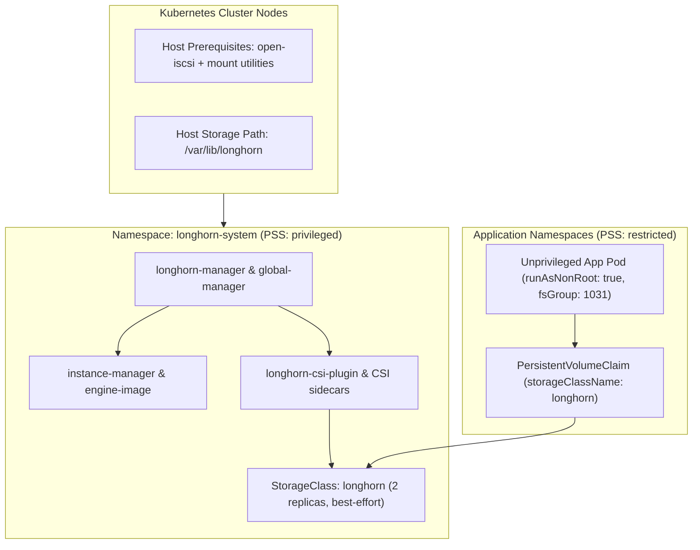

# lab-longhorn-pvc

Source of truth, documentation, and Helm umbrella chart extending the official [Longhorn](https://longhorn.io/) Helm chart (`v1.13.0`) for deployment into Kubernetes clusters enforcing `restricted` **Pod Security Standards (PSS)** by default.

---

## Features

- **Helm Umbrella Chart (`chart/`)**:
  - Wraps and locks the upstream `longhorn/longhorn` (`v1.13.0`) Helm chart.
  - Pins all Longhorn workloads and RBAC subjects to `longhorn-system` (`namespaceOverride: "longhorn-system"`).
  - Pre-configured defaults for compact clusters: `2` replicas, `best-effort` data locality, and control-plane node tolerations across both Helm-managed and Longhorn-spawned pods.
  - Optional declarative `Namespace` template (`chart/templates/namespace.yaml`) and extra `StorageClass` definitions (`chart/templates/storageclass.yaml`).
- **Privileged Namespace Manifest (`manifests/namespace.yaml`)**:
  - Standalone `Namespace` manifest configuring `pod-security.kubernetes.io/{enforce,audit,warn}: privileged` specifically for `longhorn-system` before Helm installation.
- **Environment & Tooling (`mise` & `hk`)**:
  - `mise.toml`: Tool version management (`helm`, `betterleaks`, `addlicense`, `trivy`, `actionlint`, `shellcheck`, `zizmor`, `hk`, `pkl`, `tombi`, `yamllint`) and convenient deployment task aliases.
  - `hk.pkl`: Fast git hooks and project checks enforcing Conventional Commits, branch protection, secret scanning (`betterleaks`), Helm linting, workflow linting (`actionlint`), security audits (`zizmor`), YAML linting (`yamllint`), TOML linting (`tombi`), shell checking (`shellcheck`), and license checks (`addlicense`).
- **GitHub Actions CI (`.github/workflows/`)**:
  - Reusable workflows powered by [`joeckr/ci-templates`](https://github.com/joeckr/ci-templates) for linting, secret/workflow scanning, Semantic Versioning, and publishing the packaged Helm chart to GitHub Container Registry (GHCR) as an OCI artifact.

---

## Directory Structure

```text
.
├── .github/
│   └── workflows/
│       ├── lint.yml             # Lints workflows, commits, and shell scripts
│       ├── security.yml         # Scans for secrets and audits workflow security
│       ├── release.yml          # Semantic release and Helm chart publishing to GHCR
│       └── test_release.yml     # PR dry-run test for releases and chart packaging
├── chart/
│   ├── Chart.yaml               # Umbrella Helm chart definition extending longhorn/longhorn
│   ├── Chart.lock               # Locked upstream Longhorn chart digest
│   ├── values.yaml              # Default configuration values and upstream overrides
│   ├── .helmignore              # Ignore rules for chart packaging
│   └── templates/
│       ├── _helpers.tpl         # Chart label and naming helpers
│       ├── namespace.yaml       # Optional privileged Namespace resource for GitOps/template rendering
│       ├── storageclass.yaml    # Optional additional Longhorn StorageClasses
│       └── NOTES.txt            # Post-install verification instructions
├── manifests/
│   └── namespace.yaml           # Declarative `longhorn-system` Namespace with `privileged` PSA labels
├── hk.pkl                       # hk git hooks and checks configuration
├── mise.toml                    # Mise tools and operational tasks
└── README.md
```

---

## Architecture & Pod Security Standards (PSS)

Hardened Kubernetes clusters enforce the **Pod Security Admission (PSA)** `restricted` profile across user namespaces by default. While application workloads run rootless with all Linux capabilities dropped, **Longhorn** is a kernel-integrated distributed block storage and CSI system that requires elevated host privileges inside its isolated `longhorn-system` namespace—without weakening the `restricted` posture of application namespaces consuming Longhorn PVCs.



### Why `longhorn-system` Requires `privileged` Pod Security

A `baseline` or `restricted` PSS profile blocks Longhorn pods at admission time because Longhorn's control and data plane components perform host-level storage operations:

| Component | Required Privileges | Reason |
|---|---|---|
| `longhorn-manager` (`DaemonSet`) | `privileged: true`, `hostPath` (`/dev`, `/proc`, `/boot`, `/etc`, `/var/lib/longhorn`), `mountPropagation: Bidirectional` | Discovers host disks, manages node block devices, and coordinates volume mounts with host propagation. |
| `instance-manager` & `engine-image` | `privileged: true`, `hostPath` | Manages block replicas, iSCSI targets (`iscsid`/`iscsiadm`), and data engines per node. |
| `longhorn-csi-plugin` (`DaemonSet`) | `privileged: true`, `hostNetwork: true`, `hostPID: true`, `mountPropagation: Bidirectional` | Attaches iSCSI block devices on the host, formats filesystems (`ext4`/`xfs`), and bind-mounts volumes into `/var/lib/kubelet/pods`. |
| `longhorn-driver-deployer` & Upgrade Jobs | `runAsUser: 0` / `privileged: true` | Bootstraps CSI deployments and performs pre-upgrade host kernel/environment checks. |
| **Consumer Workloads (Other Namespaces)** | **None (`restricted` PSS compliant)** | **Run with `runAsNonRoot: true`, `allowPrivilegeEscalation: false`, `capabilities.drop: ["ALL"]`, `seccompProfile: RuntimeDefault`, and `fsGroup` for PVC write access.** |

---

## Cluster Prerequisites

Before deploying this chart, ensure your Kubernetes cluster meets the following requirements:

1. **Node Storage Utilities**:
   - **Standard Linux distributions**: `open-iscsi` (`iscsid` running and enabled), `util-linux` (`findmnt`, `grep`, `awk`, `blkid`, `lsblk`), and `curl` installed on each storage node. (Install `nfs-common` / `nfs-utils` if using `ReadWriteMany` volumes, or `cryptsetup` / `dmsetup` if using encrypted volumes.)
   - **Immutable OS distributions (e.g., Talos Linux)**: Ensure system extensions providing `iscsi-tools` and `util-linux-tools` are installed on participating nodes.
2. **Privileged `longhorn-system` Namespace**:
   - In clusters enforcing `restricted` or `baseline` PSA cluster-wide, the `longhorn-system` namespace must carry `pod-security.kubernetes.io/enforce: privileged` (provided in [`manifests/namespace.yaml`](manifests/namespace.yaml)) and, if your API server admission configuration restricts privileged namespaces, be listed in the `PodSecurity` admission controller's `exemptions.namespaces`.

---

## Chart Defaults & Customizations

[`chart/values.yaml`](chart/values.yaml) extends the upstream `longhorn/longhorn` (`1.13.0`) chart with defaults tuned for compact clusters:

| Setting | Default in `chart/values.yaml` | Purpose |
|---|---|---|
| `longhorn.namespaceOverride` | `"longhorn-system"` | Pins all Longhorn resources and RBAC `ClusterRoleBinding` subjects to `longhorn-system` when rendered as a subchart. |
| `longhorn.global.tolerations` | `control-plane` & `master` (`Exists`, `NoSchedule`) | Allows Helm-managed workloads (`longhorn-manager`, `longhorn-global-manager`, `longhorn-driver-deployer`, `longhorn-ui`, hook Jobs) to schedule on tainted control-plane nodes. |
| `longhorn.defaultSettings.taintToleration` | `node-role.kubernetes.io/control-plane:NoSchedule;...` | Allows Longhorn's dynamically spawned system pods (`instance-manager`, `engine-image`, `longhorn-csi-plugin`, CSI sidecars) to schedule on control-plane nodes. |
| `longhorn.csi.kubeletRootDir` | `"/var/lib/kubelet"` | Standard kubelet root directory for the CSI plugin. |
| `longhorn.defaultSettings.defaultDataPath` | `"/var/lib/longhorn"` | Host directory on cluster nodes where Longhorn stores volume replicas. |
| `longhorn.persistence.defaultClassReplicaCount` | `2` | Default replica count for PVCs using the default `longhorn` `StorageClass`. |
| `longhorn.defaultSettings.defaultReplicaCount` | `{ v1: "2", v2: "2" }` | Matches UI/API volume creation replica defaults to the `StorageClass` replica count. |
| `longhorn.persistence.defaultDataLocality` | `best-effort` | Prefers keeping a local replica on the same node as the consuming pod to reduce network I/O without blocking scheduling. |
| `longhorn.csi.*ReplicaCount` & `longhornGlobalManager.replicas` | `2` | Right-sizes CSI sidecar controllers and Global Manager replicas for compact clusters while retaining HA failover. |
| `additionalStorageClasses` | `[]` | Optional list to declaratively create extra `StorageClass` presets (e.g., `longhorn-retain` with `reclaimPolicy: Retain`). |

---

## Deployment

### Option 1: Helm CLI via `mise`

> [!IMPORTANT]
> Do **not** rely on `helm install --create-namespace` alone on a cluster enforcing `restricted` PSA by default. Helm's `--create-namespace` creates an **unlabeled** namespace, causing PSA to reject Longhorn's privileged DaemonSets and hook Jobs. Always apply [`manifests/namespace.yaml`](manifests/namespace.yaml) first—`mise run helm-i` automates this dependency automatically.

```sh
# 1. Lint and preview rendered manifests locally
mise run helm-l
mise run helm-t

# 2. Apply privileged `longhorn-system` namespace and install/upgrade Longhorn
mise run helm-i

# 3. Verify pods, storage nodes, and StorageClass
kubectl -n longhorn-system get pods
kubectl -n longhorn-system get nodes.longhorn.io
kubectl get storageclass

# 4. Access the Longhorn UI locally at http://localhost:8080
mise run ui
```

### Option 2: GitOps via GHCR OCI Chart

Upon release, GitHub Actions packages `chart/` (bundling the locked `longhorn` subchart dependency) and publishes it as an OCI artifact to GHCR.

#### Flux CD (`OCIRepository` + `HelmRelease`)

Ensure `manifests/namespace.yaml` is applied (or manage the `Namespace` with the `privileged` PSA labels in Flux):

```yaml
apiVersion: v1
kind: Namespace
metadata:
  name: longhorn-system
  labels:
    pod-security.kubernetes.io/enforce: privileged
    pod-security.kubernetes.io/enforce-version: latest
    pod-security.kubernetes.io/audit: privileged
    pod-security.kubernetes.io/audit-version: latest
    pod-security.kubernetes.io/warn: privileged
    pod-security.kubernetes.io/warn-version: latest
---
apiVersion: source.toolkit.fluxcd.io/v1beta2
kind: OCIRepository
metadata:
  name: lab-longhorn-pvc
  namespace: flux-system
spec:
  interval: 1h
  url: oci://ghcr.io/joeckr/charts/lab-longhorn-pvc
  ref:
    semver: ">=0.1.0"
---
apiVersion: helm.toolkit.fluxcd.io/v2
kind: HelmRelease
metadata:
  name: longhorn
  namespace: longhorn-system
spec:
  interval: 30m
  targetNamespace: longhorn-system
  chartRef:
    kind: OCIRepository
    name: lab-longhorn-pvc
    namespace: flux-system
  install:
    crds: CreateReplace
  upgrade:
    crds: CreateReplace
```

#### Argo CD (`Application`)

When deploying with Argo CD:
1. Use `managedNamespaceMetadata` with `CreateNamespace=true` so Argo CD labels `longhorn-system` as `privileged` before syncing workloads.
2. Override `longhorn.preUpgradeChecker.jobEnabled: false` because Argo CD maps Helm `pre-upgrade` hooks to `PreSync`, which would otherwise run on initial install before `longhorn-service-account` exists.

```yaml
apiVersion: argoproj.io/v1alpha1
kind: Application
metadata:
  name: longhorn
  namespace: argocd
spec:
  project: default
  source:
    repoURL: ghcr.io/joeckr/charts
    chart: lab-longhorn-pvc
    targetRevision: 0.1.0
    helm:
      valuesObject:
        longhorn:
          preUpgradeChecker:
            jobEnabled: false
  destination:
    server: https://kubernetes.default.svc
    namespace: longhorn-system
  syncPolicy:
    automated:
      prune: true
      selfHeal: true
    managedNamespaceMetadata:
      labels:
        pod-security.kubernetes.io/enforce: privileged
        pod-security.kubernetes.io/enforce-version: latest
        pod-security.kubernetes.io/audit: privileged
        pod-security.kubernetes.io/audit-version: latest
        pod-security.kubernetes.io/warn: privileged
        pod-security.kubernetes.io/warn-version: latest
    syncOptions:
      - CreateNamespace=true
      - ServerSideApply=true
```

---

## Consuming Longhorn PVCs in `restricted` PSS Namespaces

Application namespaces remain strictly under `pod-security.kubernetes.io/enforce=restricted`. Because newly formatted `ext4`/`xfs` block volumes are owned by `root:root` (`0755`) by default, non-root containers (`runAsNonRoot: true`) **must** set `spec.securityContext.fsGroup` so `kubelet` automatically grants group write access on the mounted volume without requiring root `initContainers`.

### End-to-End Verification Snippet

You can verify dynamic PVC provisioning inside a `restricted` namespace (such as `default`) with the following self-contained test:

```yaml
apiVersion: v1
kind: PersistentVolumeClaim
metadata:
  name: longhorn-restricted-test
  namespace: default
spec:
  accessModes:
    - ReadWriteOnce
  storageClassName: longhorn
  resources:
    requests:
      storage: 1Gi
---
apiVersion: v1
kind: Pod
metadata:
  name: longhorn-restricted-test
  namespace: default
spec:
  automountServiceAccountToken: false
  securityContext:
    runAsNonRoot: true
    runAsUser: 1031
    runAsGroup: 1031
    fsGroup: 1031
    fsGroupChangePolicy: OnRootMismatch
    seccompProfile:
      type: RuntimeDefault
  containers:
    - name: writer
      image: busybox:1.37
      command:
        - sh
        - -c
        - "echo 'hello from restricted pod' > /data/test.txt && cat /data/test.txt && sleep 3600"
      securityContext:
        allowPrivilegeEscalation: false
        readOnlyRootFilesystem: true
        capabilities:
          drop:
            - ALL
      volumeMounts:
        - name: data
          mountPath: /data
  volumes:
    - name: data
      persistentVolumeClaim:
        claimName: longhorn-restricted-test
```

Clean up after verifying `kubectl logs longhorn-restricted-test`:

```sh
kubectl delete pod/longhorn-restricted-test pvc/longhorn-restricted-test -n default
```

---

## Uninstalling Longhorn

To protect persistent data against accidental deletion, Longhorn blocks uninstallation until the `deleting-confirmation-flag` setting is explicitly set to `"true"`. The `mise run helm-u` task patches this setting automatically before uninstalling:

```sh
# 1. Patch deleting-confirmation-flag and uninstall the Helm release
mise run helm-u

# 2. Optionally remove the namespace once cleanup finishes
kubectl delete -f manifests/namespace.yaml
```

---

## Local Development & Tasks

### Setup

```sh
# Install tools and git hooks
mise run install
```

### Available Tasks

Run tasks with `mise run <task>`:

| Task | Description | Command |
|---|---|---|
| `install` | Install tools and set up git hooks | `hk install --mise` |
| `hk` (or `check`) | Run all linters and hook checks | `hk check --all` |
| `helm-d` | Add Longhorn Helm repo and build chart dependencies | `helm dependency build chart/` |
| `helm-up` | Update upstream Longhorn dependency and `Chart.lock` | `helm dependency update chart/` |
| `helm-l` | Lint Helm umbrella chart | `helm lint chart/` |
| `helm-t` | Render Helm chart templates to `rendered.yaml` | `helm template longhorn chart/ --namespace longhorn-system > rendered.yaml` |
| `helm-ns` | Apply `privileged` PSS `longhorn-system` namespace | `kubectl apply -f manifests/namespace.yaml` |
| `helm-i` | Apply privileged namespace and install/upgrade Longhorn | `helm upgrade --install longhorn chart/ --namespace longhorn-system` |
| `helm-u` | Confirm deletion flag and uninstall Longhorn from `longhorn-system` | `helm uninstall longhorn --namespace longhorn-system` |
| `ui` | Port-forward Longhorn UI to `http://localhost:8080` | `kubectl -n longhorn-system port-forward svc/longhorn-frontend 8080:80` |
| `trivy-fs` | Scan repository filesystem for security vulnerabilities | `trivy fs .` |

---

## Conventional Commits & Releases

Commits must follow the [Conventional Commits](https://www.conventionalcommits.org/) specification:
- `feat: add new feature` -> Triggers a **minor** release (e.g., `v0.1.0` -> `v0.2.0`).
- `fix: resolve issue` -> Triggers a **patch** release (e.g., `v0.1.0` -> `v0.1.1`).
- `feat!: breaking change` -> Triggers a **major** release.
- `chore:`, `docs:`, `ci:`, `test:`, `refactor:` -> Maintenance changes (no release bump).

Upon merging to `main`, the `release.yml` workflow automatically computes the next version, updates `version` and `appVersion` in `chart/Chart.yaml`, creates a Git tag, publishes a GitHub Release, and packages and pushes the Helm chart to GHCR.

## Support

If you find this project useful, consider supporting my work on [Ko-fi](https://ko-fi.com/joeckr):

[](https://ko-fi.com/joeckr)

## License

Please refer to the `LICENSE` file for details.
